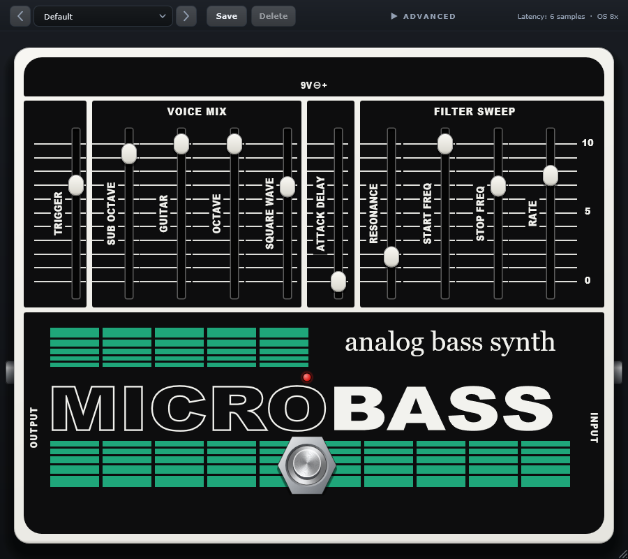

# MicroBass

Plugin de sintetizador de baixo analógico (VST3 e Standalone para Windows). Ele emula, componente a componente, o circuito de um pedal de bass synth monofônico do fim dos anos 70: sub-oitava por divisor de frequência, oitava acima por retificação, onda quadrada, VCA com ataque lento e um filtro ressonante com varredura automática. Não usa detecção de pitch: tudo segue a forma de onda do baixo, como no hardware.

## Download

Baixe a versão mais recente em **[Releases](../../releases/latest)**:

| Arquivo | Para quem |
|---|---|
| `MicroBass-x.y.z-Windows-Setup.exe` | Instalador. Instala o VST3 em `C:\Program Files\Common Files\VST3` e o Standalone em `C:\Program Files\MicroBass`. |
| `MicroBass-x.y.z-Windows.zip` | Instalação manual (o `LEIA-ME.txt` dentro do zip explica). |

**Requisitos:** Windows 10 ou 11 (64 bits) e uma DAW com suporte a VST3 (REAPER, Cubase, Studio One, Ableton Live, FL Studio, Bitwig…). O Standalone funciona sem DAW.

**Feche a DAW antes de instalar.** Depois, peça para ela reescanear os plugins.

> O instalador não é assinado digitalmente. Se o Windows mostrar "O Windows protegeu o computador", clique em **Mais informações → Executar assim mesmo**. Os hashes SHA-256 de cada arquivo estão na página do release.

## Controles

| Slider | O que faz |
|---|---|
| **TRIGGER** | Sensibilidade do disparo do filtro e do VCA. Alto demais faz o som "picotar" em acordes. |
| **SUB OCTAVE** | Uma oitava abaixo, gerada pelo divisor. |
| **GUITAR** | Sinal limpo do baixo. |
| **OCTAVE** | Uma oitava acima (retificador). |
| **SQUARE WAVE** | Onda quadrada na frequência da nota. |
| **ATTACK DELAY** | Tempo de entrada do volume (de ataque seco a swell). |
| **RESONANCE** | Ressonância do filtro. |
| **START FREQ / STOP FREQ** | Onde a varredura do filtro começa e termina a cada nota. |
| **RATE** | Velocidade da varredura. |

Em **Advanced** ficam o ganho de entrada, o nível de saída e o oversampling (2x/4x/8x). Vem com 6 presets de fábrica.

## Dicas

- Toque uma nota de cada vez: o circuito é monofônico, como o original.
- Se o filtro não recomeça a varredura a cada nota, suba o **TRIGGER**; se "picota" em acordes, abaixe.
- O LED vermelho fica aceso com o efeito ligado; o footswitch liga e desliga (bypass).
- Passe o mouse num fader para ver o valor; duplo clique volta ao padrão.
- START = STOP congela o filtro numa frequência fixa.

## Problemas e sugestões

Abra uma [issue](../../issues).
